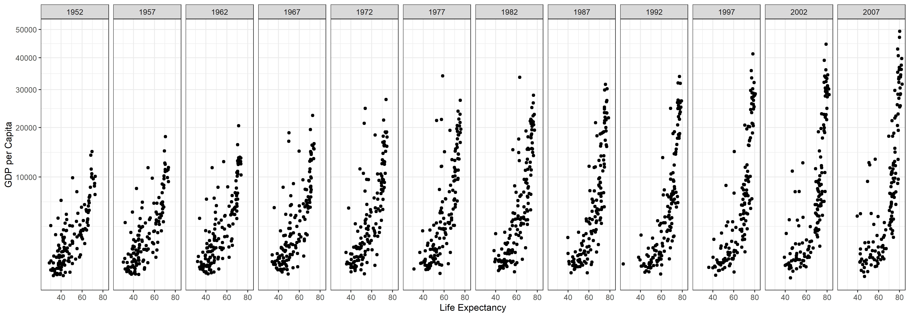
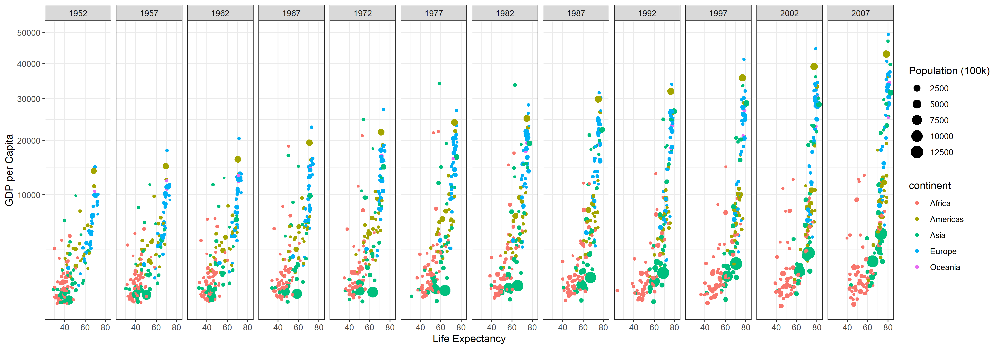

::: panel-tabset
## Resources

### Reading

Finish reading the rest of [Chapter 3: R for Data Science---Visualization](https://r4ds.had.co.nz/data-visualisation.html)

## Background

[Hans Rosling](http://www.gapminder.org/news/sad-to-announce-hans-rosling-passed-away-this-morning/) is one of the most popular data scientists on the web. His original TED talk, [The best stats you've ever seen](https://www.ted.com/talks/hans_rosling_shows_the_best_stats_you_ve_ever_seen) set a new bar for data visualization. We are going to create some graphics using his formatted data.

## Pre

1.  Use a `.qmd` file to recreate the graphic shown below using `gapminder` dataset from `library(gapminder)` (get them to match as closely as you can).
    -   Remove Kuwait from the data ([explanation of why](https://github.com/jennybc/gapminder/issues/9))
    -   Use `library(tidyverse)` to load ggplot2 and dplyr so that you can duplicate the plot below. (Hint: use `+ theme_bw()` to get the proper formatting)
    -   Use `scale_y_continuous(trans = "sqrt")` to get the correct scale on the y-axis.
    -   Use `ggsave()` and save the plot as a `.png`
2.  Render the `.qmd` file. Push your `.qmd`, `.md`, `.html` and the `.png` of the plot into your git repository.

## Post

1.  Edit the `.qmd` file created in the *pre class* task to incorporate population size and continent, as seen below:

Don't forget that slack is a great place to go if you can't figure something out. Asking questions in a way that allows people to help you is a skill you can practice in slack and within your groups.

2.  Render the updated `.qmd` file. Push your `.qmd`, `.md`, `.html` and the `.png` of the plot into your git repository.

### Submit

In I-learn submit a link to the `.md` file on GitHub.
:::
