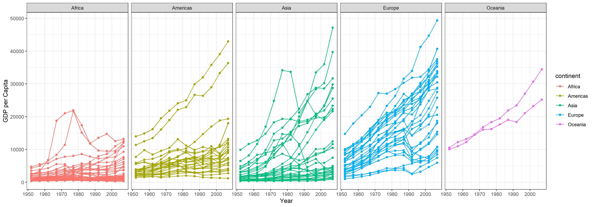
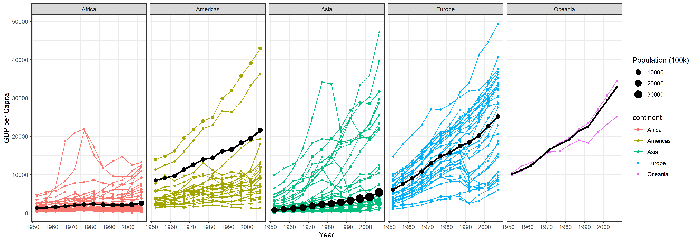

::: panel-tabset
## Resources

### Reading

**This may be the most important reading of the semester** since we will use these transformation skills extensively the rest of the semester.

[Chapter 5: Data Transformation](https://r4ds.had.co.nz/transform.html)

### Guided Instruction

Read and complete the exercises in the `.qmd` file (you may wish to Render the file first for easier reading): [data wrangling with dplyr](https://byuistats.github.io/M335/online_class/week3-dplyr.Rmd)

## Background

[Hans Rosling](http://www.gapminder.org/news/sad-to-announce-hans-rosling-passed-away-this-morning/) is one of the most popular data scientists on the web. His original TED talk, [The best stats you've ever seen](https://www.ted.com/talks/hans_rosling_shows_the_best_stats_you_ve_ever_seen) set a new bar for data visualization.

## Pre

1.  **Look at GDP over time.** Recreate the graphic shown below using gapminder dataset from `library(gapminder)` (get them to match as closely as you can).
    -   Remove Kuwait from the data.
    -   Use `library(tidyverse)` to load ggplot2 and dplyr, and use theme_bw() to duplicate basic plot formatting.
2.  Build an `.qmd` file to complete this task.
3.  Render your `.qmd` and then push your `.qmd`, `.md`, `.html` into your git repository.

### Plot to recreate:

## Post

1.  Edit the `.qmd` file created in the *pre class* task to incorporate a weighted mean for each facet, as shown below (continent mean should be weighted by country's population size).

    -   Build a weighted average data set using `weighted.mean()` and GDP with `summarise()` and `group_by()`. You will need to use this weighted average dataset to make the black lines and dots that show the continent weighted average.

2.  Render the updated `.qmd` file. Push your `.qmd`, `.md`, and `.html` into your git repository.

### Submit

In I-learn submit a link to the `.md` file on GitHub.
:::
