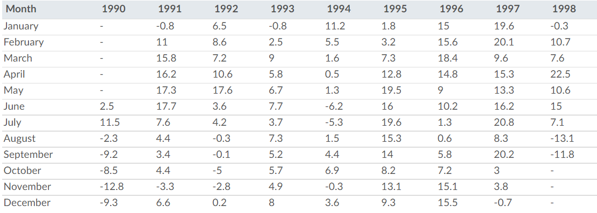

::: panel-tabset
## Resources

### Readings

- [Chapter 11.5 Writing Data: R for Data Science (2nd ed)](https://r4ds.had.co.nz/data-import.html#writing-to-a-file)
- [Chapter 12 Tidy Data: R for Data Science](http://r4ds.had.co.nz/tidy-data.html) (1st ed)
  - (optional) For more complex pivoting examples, read the 2nd edition chapter: [Chapter 5 Data Tidying: R for Data Science (2nd ed)](https://r4ds.hadley.nz/data-tidy)
  - (optional) A more robust function for extracting strings can be found in [Chapter 14 Strings: R for Data Science (2nd ed)](https://r4ds.hadley.nz/strings). Section 14.4 is particularly relevant to this task.
- [RDS vs. RData](http://www.sthda.com/english/wiki/saving-data-into-r-data-format-rds-and-rdata)
  - By the way, contrary to what the article suggests, I don't believe saving your workspace is a good idea unless you think you'll need it. It just slows down your computer. That's the point of a script or markdown file, all the code is already saved so you can reproduce the workspace if necessary.
- [tidyr cheatsheet](https://rstudio.github.io/cheatsheets/tidyr.pdf)

### Guided Instruction

1.  [tidyr](https://byuistats.github.io/M335/online_class/week4-tidyr.Rmd)
2.  [Reading and Writing R files](https://byuistats.github.io/M335/online_class/week4-reading-writing_Rfiles.Rmd)

## Background

This assignment centers on the Efficient Market Hypothesis (EMH)—the idea that stock prices reflect all available information, making it impossible to "beat the market" consistently through skill alone.

In 1973, Burton Malkiel published his seminal book, A Random Walk Down Wall Street. He famously claimed:

> "A blindfolded monkey throwing darts at a newspaper's financial pages could select a portfolio that would do just as well as one carefully selected by experts."

His argument was that stock price movements are "random walks"—meaning past patterns cannot predict future movement. Therefore, paying fees for professional "stock picking" is often a waste of money compared to buying a broad market index.

**The WSJ "Dartboard Contest" (1990–2002)** The Wall Street Journal (WSJ) created a monthly competition to test this theory. Here is how it worked:

- **The Pros**: Four investment experts were invited to pick one stock each that they believed would outperform the market over the next six months.
- **The Darts**: WSJ staffers acted as the "monkeys," throwing darts at a stock listing page pinned to a board.
- **The Benchmark (DJIA)**: They compared both groups against the DJIA (Dow Jones Industrial Average). This was like a control group and allows us to see if anyone was actually providing returns above the market average.

We want to look at the returns for each six-month period of the year in which the returns were reported. The experiment ran through 2002, but we have access to stock return data only through 1998.

*The Dow Jones Industrial Average is a group of 30 stocks for large companies with stable earnings. This "index" of stocks is one of the oldest, most closely watched indices in the world and is designed to serve as a proxy, or indicator, of the United States economy in general. ([learn about about "the Dow".](https://www.investopedia.com/terms/d/djia.asp))*

## Task

1.  Use the appropriate function in `library(readr)` to read in the `.RDS` file found on [GitHub](https://github.com/byuistats/data/tree/master/Dart_Expert_Dow_6month_anova)
    - Depending on your computer, you should use `read_rds(url("WEBLOCATION.RDS"))` or `read_rds("WEBLOCATION.RDS")` to download and read the .RDS file type. Remember, R is case sensitive. Replace `WEBLOCATION.RDS` with the correct url address.
    - When using file paths to read files in from Github (and other locations), you must pay attention to 'raw' vs. 'blob' (seeing this [reading](Task_08_gun_deaths.qmd)).
2.  The `contestant_period` column is not "tidy" we want to create a `month_end` and a `year_end` column from the information it contains.
3.  Save your "tidy" data as an `.rds` object. (as an optional challenge, see if you can read in the saved file!)
4.  Use code to create a table of the DJIA returns that matches the table shown below (apply `pivot_wider()` to the data). Pay attention to detail.

6.  Render the `.qmd` file. Push all the files created in the rendering process into your GitHub repository.

### Submit

In I-learn submit the link to your `html` file hosted on your repo's GitHub pages.
:::
