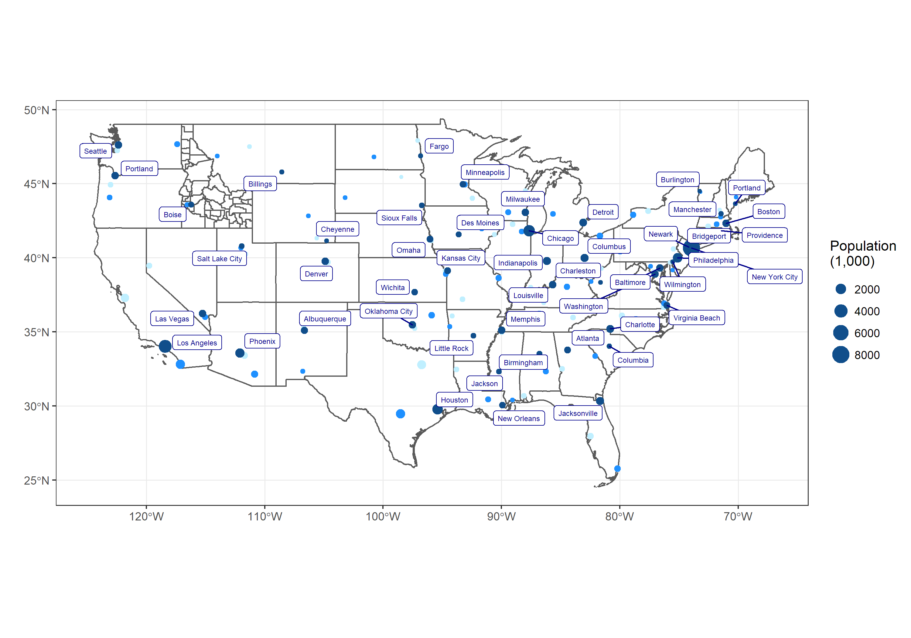

::: panel-tabset
## Resources

### Readings

1.  [Using SF package with tidyverse](https://byuistats.github.io/M335/online_class/week12-spatial_reading.html#Spatial_Data_in_R)
2.  [SF R package](https://r-spatial.github.io/sf/articles/sf1.html) Read through the section titled, "sfc: simple feature geometry list-column."
3.  [USA Boundaries](https://github.com/ropensci/USAboundaries)

### Guided Instruction

This video provides a demonstration of how to use geometry and spatial data to tackle a visualization similar to the task.

1.  [Video example of geom_sf](https://www.loom.com/share/535ff204fb0143ec9301e636216f28ec)

## Background

Up to this point, we have dealt with data that fits into the tidy format without much effort. Spatial data has many complicating factors that have made handling spatial data in R complicated.

We will use `library(USAboundaries)` and `library(sf)` to make a map of the US and show the top three largest cities in each state. Specifically, you will use `library(ggplot2)` and the function `geom_sf()` to recreate the provided image.

We want to create a map of the United States that plots the three largest cities (according to population) in each state - colored according to their rank. We also want to draw the shapes of the Idaho counties on the same plot.

## Pre

1.  Create a map of the 48 continguous United States where each state is outlined and where the counties of Idaho are outlined. Here are some hints to keep in mind for this task (the *pre class* and *post class* portions).
    -   From `library(USAboundaries)` use `us_states()` and `us_counties()` to get the state and county shape geometries
    -   Remember that R has some helpful variables called `state.name` and `state.abb`
2.  Create a dataset that only contains rows for the top 3 cities in each of the 48 continuous states and has a column that contains their ranking (either a 1, 2, or 3).
    -   From `library(USAboundaries)` use `us_cities()` to get a starting dataset and then do your wrangling from there.
3.  Render the `.qmd`. Push the `.qmd`, `.md`, and `.html` files to your GitHub repository.

## Post

1.  Build on the progress you made in the *pre class* tasks in order to fully recreate this image:

-   Notice that the color of the points does not map to population size, rather it indicates the city's population rank (1st, 2nd or 3rd) within the state.
-   Note that `fill = NA` in `geom_sf()` will not fill the polygons with a grey color, rather it makes the fill transparent.
-   To add the labels to the image consider using library(ggrepel)
-   The labels may not look correct until you save the map as a larger image.

2.  Save your chart as a .png image. Try using ggsave() with width = 15 and height = 10. What hap\`pens if you change the width and height?

3.  Render the `.qmd`. Push the `.png`, `.qmd`, `.md`, and `.html` files to your GitHub repository.

### Submit

In I-learn submit a link to the `.md` file on GitHub.
:::
