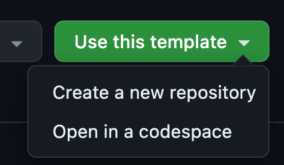
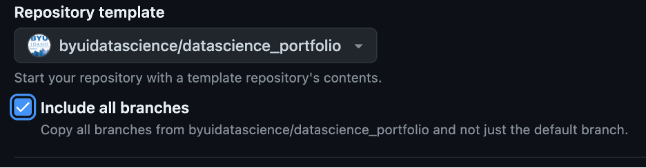
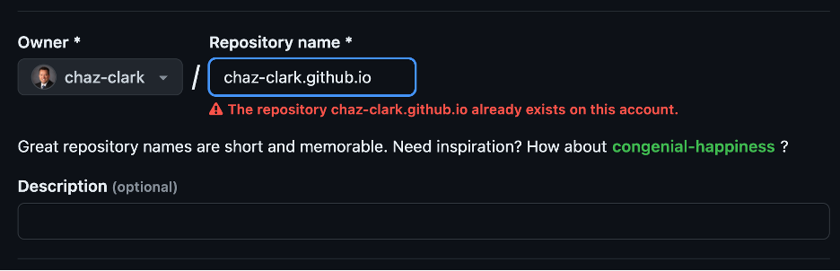
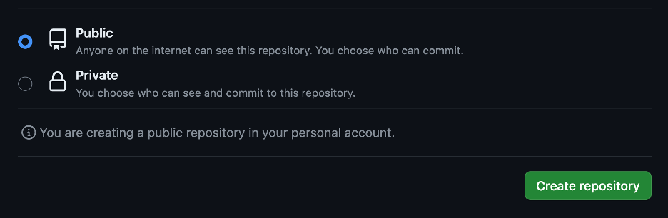
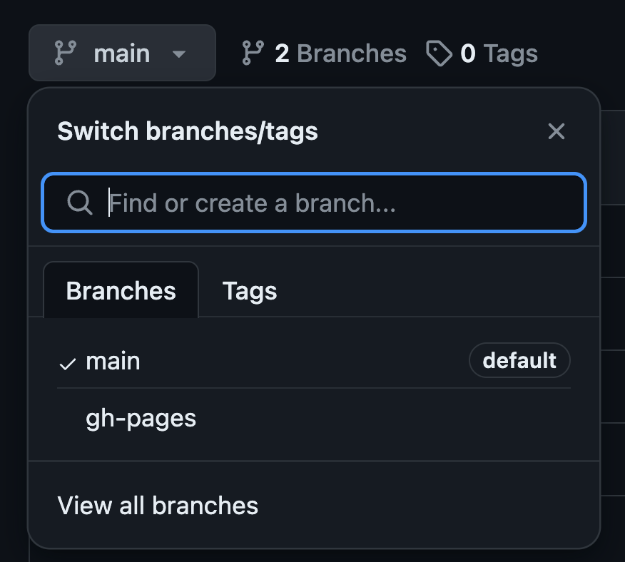
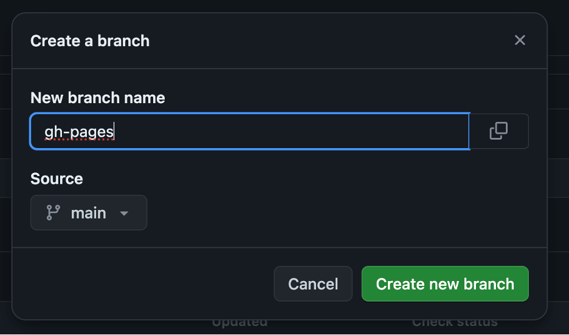
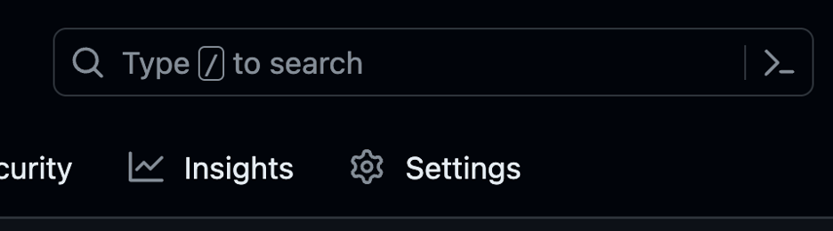
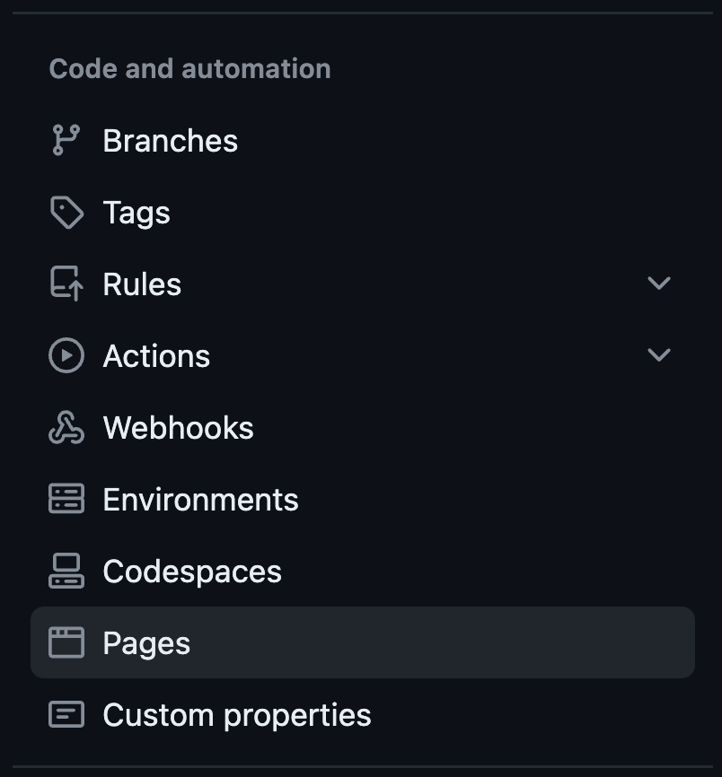
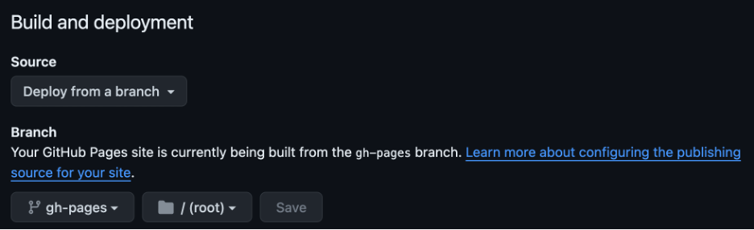
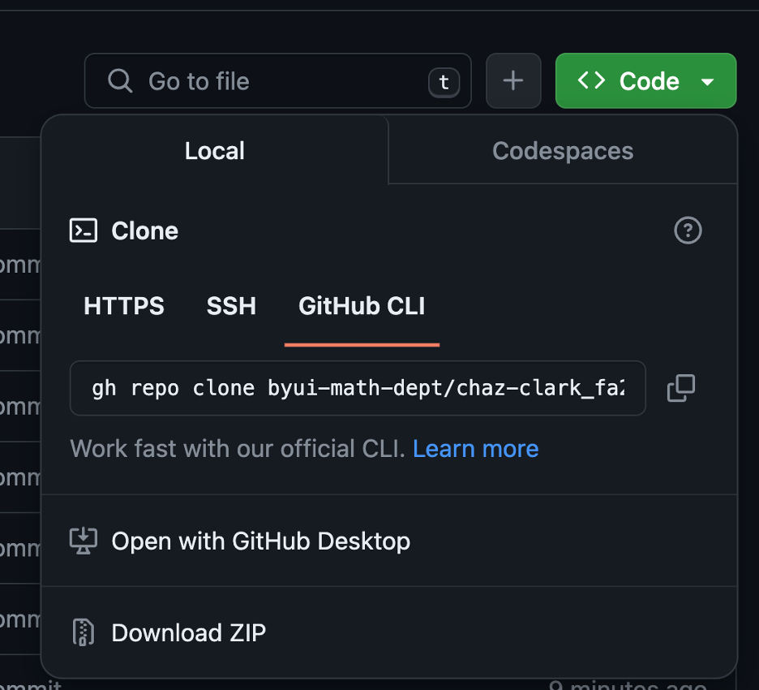

### Background

GitHub is an online platform where data scientists and developers can communicate and share work. It has also morphed into a tool to house all your work in a portfolio. Think about an Art student and how they have to develop their portfolio of various skills they have across the art classes. Similarly you will want to showcase you skillset across the Data Science skillsets.

As students, you will want to curate your creative work on GitHub using a program called Git. GitHub is the place to share your original work, **not your homework assignments**. The reading assignments will dive deaper into what to include in your portfolio and what not to include.

Many people store their personal websites, blogs, and project websites on GitHub. Our textbook and course are hosted on GitHub, and you can see [J. Hathaway's](http://jhathaway.io/) or [Ryan Hafen's](https://ryanhafen.com/) personal Data Science websites that are hosted on GitHub as well.

For this project, you will be making a public website that is a data science portfolio that will be hosted on GitHub. Your Resume will be one section of your portfolio/website. You should also post Data Science Society projects, personal projects, and any other data science related work you have done outside of class. Do not post any of the DS250 course work in this portfolio.

### Data

**Portfolio:** [BYUI Data Science Portfolio](https://github.com/byuidatascience/datascience_portfolio)

### Readings

-   [New to Git and GitHub? This Essential Beginners Guide is for you](https://www.analyticsvidhya.com/blog/2020/05/git-github-essential-guide-beginners/)
-   [Git vs. GitHub: What is the difference between them?](https://www.theserverside.com/video/Git-vs-GitHub-What-is-the-difference-between-them#:~:text=The%20key%20difference%20between%20Git,and%20upload%20or%20download%20resources.)
-   [Setting up a website using Quarto documents](https://quarto.org/docs/publishing/github-pages.html#:~:text=There%20are%20three%20ways%20to,publish%20from%20the%20docs%20directory.)

#### Optional

-   [Using Version Control in VS Code](https://code.visualstudio.com/docs/editor/versioncontrol)

##### Portfolio Resources

-   [How to Modify a Quarto Website](https://quarto.org/docs/websites/website-tools.html)
-   [How to Create a Compelling GitHub Portfolio](https://towardsdatascience.com/how-to-create-a-compelling-github-portfolio-a229e7472a92)
-   [How to Create a Professional Portfolio on GitHub](https://towardsdatascience.com/how-to-create-a-professional-portfolio-on-github-that-will-help-land-your-first-job-in-data-science-e1fc8bd7a797)
-   [Data Science Portfolios That Will Get You the Job](https://www.dataquest.io/blog/build-a-data-science-portfolio/)
-   [4 Data Science Portfolio Projects You Need to Create](https://builtin.com/data-science/data-science-portfolio-projects)
-   [Example 1 - Data Science Portfolio](https://github.com/rodrigo-arenas/portfolio)
-   [Example 2 - Data Science Portfolio](https://github.com/topics/portfolio-website)

### Questions and Tasks

There are multiple ways to set-up a website using quarto documents. A succinct synopsis of the [3 ways is found here](https://quarto.org/docs/publishing/github-pages.html#:~:text=There%20are%20three%20ways%20to,publish%20from%20the%20docs%20directory.). We will walk through the first and 3rd ways.

The first option is to “Render sites on your local machine to the `docs` directory, check the rendered site into GitHub, and then configure your GitHub repo to publish from the `docs` directory. This is referred to as Method 1 below. We will show how to do this using a starting template, or from scratch. The 3rd option (also called Method 3) is to “Use a GitHub Action to automatically render your files and publish the resulting content whenever you push a source code (e.g. quarto file) change to your repository”. This will be illustrated using a template file as a starting point.

Choose 1 of the 3 tabs below and follow those instructions for publishing a portfolio website hosted through your own personal GitHub repository.

::: panel-tabset
## Method 1: Use a template, publish from docs

1.  Navigate to the [Data Science Portfolio2](https://github.com/byuidatascience/ds_portfolio_dp) repo in GitHub

2.  Click the green button ‘Use this template’ and select 'Create a new repository'

    a\. Select yourself as owner

    b\. Pick a professional name (potential employers will be seeing this)

    c\. Choose 'public'

    d\. Click 'create repository'

3.  Copy the url of the GitHub repo. You’ll need this when we return to R Studio

4.  Modify 'Pages' Setting for build and deployment from \\docs folder

    a\. Click the Settings tab

    b\. Scroll down to the Pages section on the left hand menu

    c\. Change the branch option from “none” to “main” (or "master"), and change the folder next to it from “/(root)” to “/docs”.  **Don’t forget to click 'Save'!**

    d\. Wait a couple of minutes and refresh your page. There should now be a url address to the website and a link that says “Visit Site”. This is the url address to your home page! You will want to come click on that later to access the website at the end of this process.

    **Now go to R Studio**

5.  Clone the GitHub repository to your local machine

    a\. Go to the File menu, select "New Project". Select "Version Control", and then "Git".

    b\. You are prompted to paste the url to the GitHub repository.

    -   You are also asked where to store it. Create a new folder that does not reside within any other projects or GitHub repo folders. You can now select "Create Project".

6.  You can now make changes to any of the pages, delete pages, or add pages. Be sure to render or preview the pages you made changes to. This will create the .html file the website needs and store it in the docs folder.

    **Note**: If you make changes to the menu options along the top or side of the website by editing the \_quarto.yml file you will need to render the entire website (since those options are on every page). To do that, type \`quarto render\` in the terminal. Alternatively, from the "Build" tab (which is located in the upper right pane by default), select "Render Book".

7.  We will now implement the "pull, add, commit push" workflow in RStudio to send our local files to GitHub. To do this, go to the terminal and type the following commands:

    -   git pull

    -   git add .

    -   git commit -m"a message of your choice"

    -   git push

    **Now let's return to GitHub to see the "finished" product!**

8.  It may take a minute, but when you return to the website (see step 4d), any changes you made should be visible.

## Method 2: From scratch, publish from docs

1.  From within R Studio, go to File -\> New Project, then choose New Directory, then choose Quarto Website.

2.  You will need to decide where to create the project. Pick (or create) a new folder that does not reside within any other projects or folders associated with GitHub repos. Then select that folder as the one to open

3.  Leave the Engine as Knitr.

4.  Check the box for "Create a git repository"

5.  Create a new folder in your project and call it "docs".

6.  At the beginning of the semester we initialized and installed git, we connected RStudio to GitHub, and installed the "usethis" package. If, for some reason, you haven't done those things by now, make sure they are done.

7.  In your RStudio console, run `usethis::use_git()`. Say "yes" if it asks you about committing or connecting.

8.  Then, run `usethis::use_github()`. This will create a new repository on GitHub and automatically connect it to your local project, pushing your initial commit. Note that this new repository will be under your own personal GitHub account, not within the school's organization like your classwork repo is.

9.  Render the index.qmd file. As it renders, it will create a folder called `_site` and put `index.html` inside of it.

10. Change the name of the `_site` folder to `docs`.

**Now within your newly created repository**

11. Modify 'Pages' Setting for build and deployment

    a\. Click the Settings tab

    b\. Scroll down to the Pages section on the left hand menu

    c\. Change the branch option from “none” to “master”, and change the folder next to it from “/(root)” to “/docs”.  **Don’t forget to click 'Save'!**

    d\. Wait a few minutes and refresh your page. There should now be a url address to the website and a link that says “Visit Site”. This is the url address to your home page! Click on it and check it out!

    **You are now essentially done. You can return to R Studio where you can add new pages, adjust the \_quarto.yml, etc. When you create a new .qmd file in the top level of the directory, then render it, the resulting .html version of the file will be placed in the docs folder. Continue on as normal with pulling, adding, committing and pushing.**

    ::: callout-note
    To see other files (besides index) put the file name or path at the end of the url. (Remember, it starts in the docs folder)

    NOTE: If you make changes to the \_quarto.yml file, you will need to rebuild the website by running \`quarto render\` in the terminal before pushing to GitHub. Quarto render will rebuild every webpage on your site.
    :::

## Method 3: GitHub actions, gh-pages branch

**Git a Data Science Portfolio in GitHub (main page)**

a.  **Use the Portfolio Template on your Githhub root directory**

    -   **Navigate to the [Data Science Portfolio](https://github.com/byuidatascience/datascience_portfolio) repo in GitHub. Note: This is a different template than what was used in the other 2 methods. It is set-up to work with GitHub actions, not publishing through the docs folder. Essentially, this will render your .qmd file in the cloud instead of locally. For quick changes, this can be a much slower process because it has to install R and all the packages each time. If you have a very large job though, it can be more effective to use GitHub's computing power instead of your own local machine.**
    -   **Click the Green Button `Use this template` and select `Create a new repository`**\
        {width="200"}
    -   **Click `include all branches` checkbox, this will include the `gh-pages` branch**\
        {width="500"}
    -   **Select yourself as the `Owner`**\
        {width="500"}
    -   **Name the repository as `username.github.io` where the username is your username on GitHub (Note: If the `username` part of the repository doesn’t exactly match your username, it won’t work, so make sure to get it right.)**
    -   **Click the Green Button `Create repository`**\
        {width="500"}

b.  **Create a new branch `gh-pages` if you forgot to check the `include all branches` box (skip otherwise)**

    -   **Click the `Branch: main` button then `view all branches`**\
        {width="300"}
    -   **Click the `New Branch` button**\
        {width="200"}
    -   **Name the branch `gh-pages` and click the Green Button `Create new branch`**\
        {width="300"}

c.  **Modify Pages Settings for Build and deployment from `main` to `gh-pages`:**

    -   **Click the `Settings` tab**\
        {width="300"}
    -   **Scroll down to the `Pages` section in the left hand menu**\
        {width="300"}
    -   **Locate the Build and deployment section and change Branch from `main` to `gh-pages` and leave the right side as `/root`**\
        {width="750"}

d.  **Clone the repository to your computer**

    -   **Click the `<> Code` menu**

    -   **Click the Green Button `<> Code` and select the copy icon for the url.**\
        {width="300"}

        **Now return to RStudio**

e.  Clone the GitHub repository to your local machine

    a\. Go to the File menu, select "New Project". Select "Version Control", and then "Git".

    b\. You are prompted to paste the url to the GitHub repository.

    -   You are also asked where to store it. Create a new folder that does not reside within any other projects or GitHub repo folders. You can now select "Create Project".

f.  The website will work, but in order for R code to render you need to make a couple of additional changes

    a.  Open the publish.yml file. It is in the .github\\workflows folder.
    b.  Remove the extra hashtag at the beginning of lines 33 through 45. This will uncomment the code. These lines of code tell GitHub which version of R to install and what packages to install. If you need additional packages, you will have to add them after line 45

g.  You can now make changes to any of the pages, delete pages, or add pages with our typical pull, add, commit and push workflow. You can, but aren't required to render or preview the pages you made changes to before pushing.

    **Note**: If you make changes to the menu options along the top or side of the website by editing the \_quarto.yml file you will need to render the entire website (since those options are on every page). To do that, from the "Build" tab (which is located in the upper right pane by default), select "Render Book".
:::

#### Put your Resume online

-   **Update the `resume.qmd` file** located at the top level folder with information about you. If doesn't have to be fancy, just make sure it is stuff about you and not Isaac Newton. See [P4DS: CH30 Markdown](https://aeturrell.github.io/python4DS/markdown.html)
-   Push your results to GitHub. Then go online to verify it was successful.

### Deliverables

Submit a URL link to your resume as a webpage hosted on GitHub.
