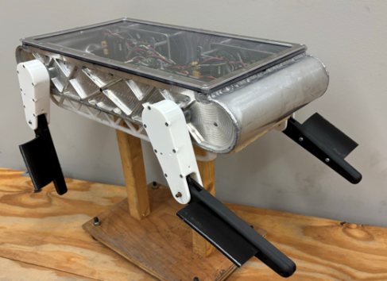

::: panel-tabset
## Reference

### Readings

1.  [Chapter 26 Iteration: R for Data Science (2e)](https://r4ds.hadley.nz/iteration.html)(Particularly [Section 26.3 Reading Multiple Files](https://r4ds.hadley.nz/iteration.html#reading-multiple-files))

2.  Cheat sheet and other documentation for [purr package](https://purrr.tidyverse.org/)

### Guided Instruction

Review/complete the guided instruction for the other tasks in this module if you have not yet.

## Background

You been asked to analyze some experimental data for a swimming robot, the goal of these experiment is to determine the effect of different gaits and leg angles on the velocity.



## Task

1.  Download the [zipped folder](https://byuistats.github.io/DS350_assignments/data/swim_robot_data.zip) and extract its files.

2.  Create a function that does the following:

    1.  Reads in all the `.txt` files that end with `-COM` into R (use `read_tsv()`as they are tab-separated values files)

    2.  Each file represents results from an experiment with the robot at certain settings. The [data dictionary](https://byuistats.github.io/DS350_assignments/data_dict_com.txt) explains the variables recorded in each experiment. For each experiment, compute the:
    
    - Average Velocity 
    - Total distance traveled 
    - Time/Duration of each experiment 


3.  Ensure you have a column with the individual file name (this will be important for the next step)

4.  Extract the following columns from the file name. You will want to look here for information on file name format [File naming convention](https://byuistats.github.io/DS350_assignments/file_naming.txt)

- Weight Distribution
- Trial Number
- Front Gait (Bean or Paddle)
- Back Gait
- Front Leg Angle
- Back Leg Angle

3.  Your table should approximately match the following table:

| weight.dist | trial | avg.velocity | total.time | total.distance | front.gait | back.gait | back.angle | front.angle |
|--------|--------|--------|--------|--------|--------|--------|--------|--------|
| Back Heavy | 1 | 0.0545458 | 8.642 | 0.3050640 | Paddle | Bean | 0 | 0 |
| Back Heavy | 2 | 0.0521141 | 8.175 | 0.2583260 | Paddle | Bean | 0 | 0 |
| Back Heavy | 3 | 0.0556096 | 8.242 | 0.3037126 | Bean | Bean | 0 | 0 |
| Back Heavy | 1 | 0.0873450 | 2.603 | 0.2256880 | Bean | Bean | 0 | 0 |
| Back Heavy | 2 | 0.1039334 | 3.987 | 0.4080110 | Bean | Bean | -20 | 0 |
| Back Heavy | 3 | 0.1075039 | 4.538 | 0.4847614 | Bean | Bean | -20 | 0 |
| Back Heavy | 1 | 0.1002619 | 5.105 | 0.5077833 | Bean | Bean | -20 | 30 |
| Back Heavy | 2 | 0.0820736 | 6.707 | 0.5435530 | Bean | Bean | -20 | 30 |
| Back Heavy | 3 | 0.0844853 | 5.372 | 0.4484674 | Bean | Bean | -20 | 30 |
| Back Heavy | 1 | 0.0621756 | 9.560 | 0.4814880 | Paddle | Bean | -20 | 0 |

```{r}
#| warning: false
#| eval: false
# data
library(pander)
library(tidyverse)
library(knitr)
library(kableExtra)

df <- read_csv("to_match.csv")
df |> kable()
```

4.  Explore the data and create a visualization or two that explores the effect of different gaits and leg angles on the velocity.

5.  Write 2-3 paragraphs explaining your findings.

### Submit

In I-learn submit the link to your `html` file hosted on your repo's GitHub pages.

:::
