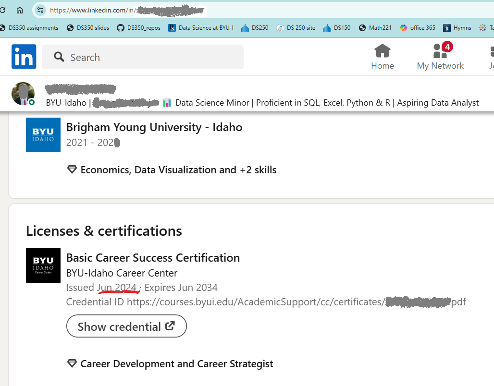

:::: panel-tabset
## Background

How do I get an internship? How can I get a job?

The BYU-Idaho Career Center has distilled the successful principles and techniques that professionals use in their job hunt. These are not just quick tricks, links to search engines, or unhelpful platitudes like "do more networking". Though little "tricks" can make an impact and websites are part of the overall approach, their Career Success program provides a framework for how to approach the job search. It points you to tools and breaks down "networking" into actionable steps any student can take. Most importantly, BYU-Idaho Career Success program walks you through bite-sized steps to get you moving on **all** the fronts needed for a successful job hunt. It helps keep you rolling toward the next step in your career.

Check out their program here:

<https://www.byui.edu/career/career-success-certification>

In addition to the long term benefits, there are short term perks like early access at career fairs, free tickets to P2B conference, and swag (t-shirts)

## Task

**Advance to the next level in the BYU-Idaho Career Success Certification.**

-   If you are not certified, then get Bronze certified.

-   If you started the semester Bronze certified, then get Silver certified.

-   If you started the semester Silver certified, get Gold certified.

-   If you started the semester as Gold certified, keep your momentum by continuing to engage career preparation. You can also encourage others and share

::: callout-warning
## Don't delay

The career success certification cannot be completed in just a day or two. Give yourself time to really benefit from the activities. It's never too early to start preparing for your career or internship.

In addition, to become certified requires meeting with a representative from the Career Center. The last couple of weeks of the semester the center is swamped and runs out of appointments. You would do well to complete the certification before week 12.
:::

### Submit

After completing your certification, the BYU-Idaho Career Center will send you a code to add to your LinkedIn account. Submit a screen shot of your LinkedIn page with your new Career Success Certification level showing (see example below). If you are already Gold Certified, send a screen shot of your LinkedIn page with the Gold certification showing.

*Note that the certification and individual identifiers should be visible. (The certification is usually located about halfway down your profile page).*

::::
