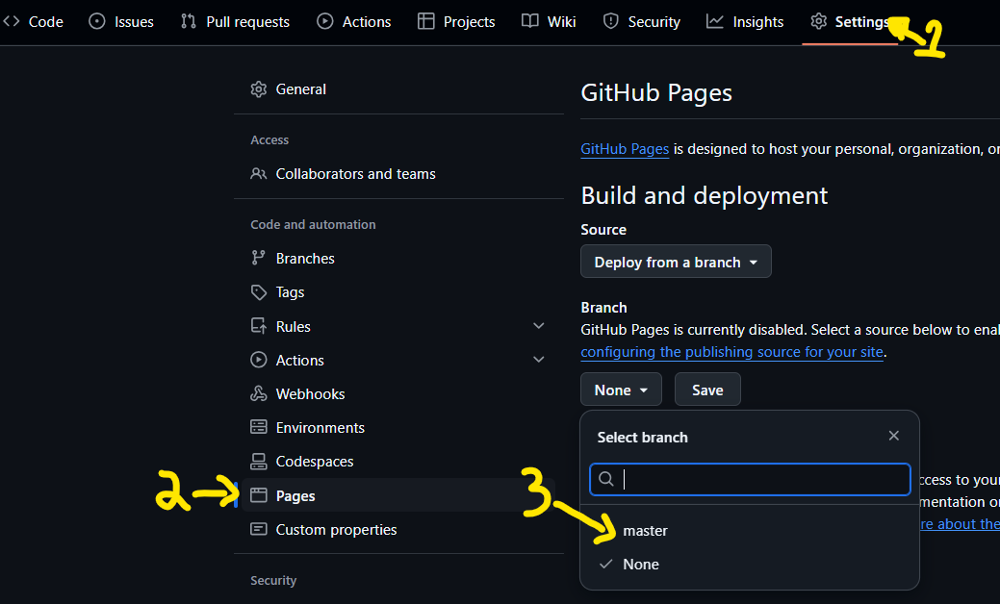
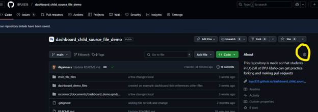
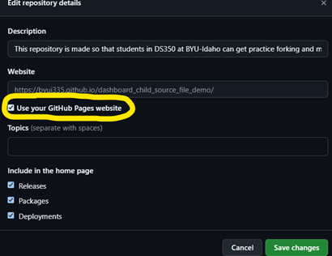
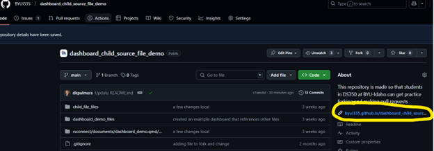

To share your .html files as visible webpages you need to enable GitHub Pages.

1.  To enable GitHub Pages, go to your repo's Settings menu (located along the top of your repo).
2.  In the menu of items that appears along the left side, select "Pages".
3.  In the Branch section of the page, use the drop down menu to change "None" to "Master".
    1.  When you select "Master" another drop down to the right will appear. Let's change that to "/docs".



It may take a minute or two, but your .html files in the "/docs" folder are now visible as webpages. To see them, you must use the url:

**https://byui335.github.io/\<repo name\>/\<file name\>**

The `<repo name>` is the name of your repo, and the `<file name>` is the name of your file (if it is in a sub-folder deeper within the /docs, be sure to include the entire path in the file name).

If you don't have a /docs folder yet, go ahead an create one on your local repository.

Everything in the /docs folder will be public. By publishing the /docs folder (instead of the /root), we still have a space on our repository that is private that others can't get to.

<!--# When you create a quarto file in your main (aka root) directory, and render it, it will automatically place an .html file in the /docs folder! -->

After enabling GitHub pages, the link to the "home page" can be found at the same place you enabled GitHub pages (Settings -\> Pages). This will link to your index.html file, or if you don’t have one, it will link to the readme.md file in the /docs folder. You can make the link to the home page very easy to get to by clicking on the gear icon in the “About” section of your \<\>Code page:



Select the box for “Use your GitHub Pages website”



Now the link to your repo’s home page is quick to get to for anyone who visits your repository.



```{r}
print("Thanks!")
```

