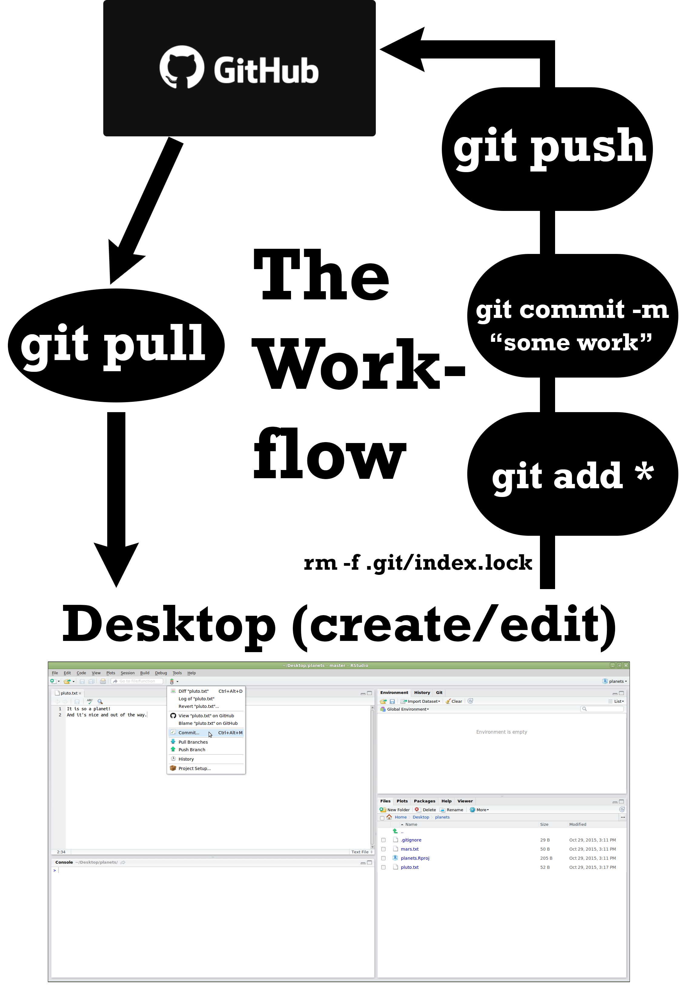

# Git Going

::: panel-tabset
## Readings

Readings teach you to do the things that a data analyst or scientist does and prepare your for the task. There are a lot of readings for this task, but many of them are short.

1.  Study [Chapter 6.2 Projects: R for Data Science (2nd ed)](https://r4ds.hadley.nz/workflow-scripts#projects)

2.  Version control systems (VCS) allow developers to maintain a record of how their code has changed over time. When used properly, a VCS can help a developer track down the exact point in time when a bug was introduced or fixed, easily undo changes, and collaborate with other developers.

    There are many types of version control systems. Some of the more popular ones include CVS, subversion, mercurial, and Git. In recent years, Git has quickly become the most popular of the group.

    Git is a program that helps you organize code and keep track of any changes you make. Git runs on your local machine, but GitHub is an online tool built around Git. This allows you to move your version control to the cloud and really facilitates collaboration with others. Git uses folders called "repositories" to organize code into different projects. GitHub is an online platform where you can store your Git repositories. You will use Git and GitHub this semester to store your homework, in a (private) repository made specifically for this class. We will manage the repositories of all the students in the class using an "organization" on GitHub.

    You should watch this [2 minute video](https://www.youtube.com/watch?v=2ReR1YJrNOM) and this [video, starting at 5:32](https://youtu.be/eWxxfttcMts?t=332) for a quick introduction to Git. (warning, in the video there is a picture of someone giving the middle finger as a rude gesture).

#### Optional, Extra Readings

-   [What is Git, a written introduction](https://www.nobledesktop.com/learn/git/what-is-git)
-   [Using version control in RStudio](https://support.rstudio.com/hc/en-us/articles/200532077-Version-Control-with-Git-and-SVN)
-   [RStudio and GitHub integration](https://www.youtube.com/watch?v=E2d91v1Twcc)
-   Chapters 4, 6, 7, and 9 of [happygitwithr](http://happygitwithr.com/github-acct.html)
-   [githug](https://github.com/jennybc/githug)
-   [Getting ready](https://byui-cs.github.io/CS246/week-04/prepare.html)
-   [Resources to learn Git](https://try.github.io/levels/1/challenges/1)
-   [Advanced tutorial](http://learngitbranching.js.org/)

## Tasks

If you have taken the class before, it's probably good to go through the installation of everything again to ensure you have the most up-to-date versions. **Don't reuse the old repository.**

If you can't complete all the tasks in this assignment, reach out for help! This assignment is critical in order to turn things in the rest of the semester. Do not simply create your own repository since we want the repository to belong to our class organization.

1.  **Install Git.** Each tab below contains a separate set of instructions, depending on your operating system: Windows, Mac, or Linux.

::: panel-tabset
## Windows

To install Git for Windows, click here: [Git for Windows](https://git-for-windows.github.io/). This will install `msysgit` or "Git Bash" in addition to some other useful tools, such as the Bash shell. Yes, all those names are totally confusing, but you might encounter them elsewhere and I want you to be well-informed.

This method of installing Git for Windows leaves the Git executable in a conventional location, which will help you and other programs, e.g. RStudio, find it and use it. This also supports a transition to more expert use, because the "Git Bash" shell will be useful as you venture outside of R/RStudio.

-   When asked about "Adjusting your PATH environment", make sure to select "Git from the command line and also from 3rd-party software". Otherwise, we believe it is good to accept the defaults.
-   Note that RStudio for Windows prefers for Git to be installed below `C:/Program Files` and this appears to be the default. This implies, for example, that the Git executable on my Windows system is found at `C:/Program Files/Git/bin/git.exe`. Unless you have specific reasons not to, follow this convention.

<!-- If you follow these instructions you can use the shell (also called the **terminal**) directly from within RStudio. We will walk you through how/when to use it in videos referenced later on this page. If you are extra ambitious see [this article for more information on how to use it and setup RStudio to use Git Bash, rather than the Command Prompt](https://support.rstudio.com/hc/en-us/articles/115010737148-Using-the-RStudio-Terminal). -->

## Mac

Mac OS X already includes the shell, so all you need to do is install Git.

### Option 1 (highly recommended)

Install the Xcode command line tools (**not all of Xcode**), which includes Git.

Go to the shell and enter one of these commands to elicit an offer to install developer command line tools:

``` bash
git --version
git config
```

Accept the offer! Click on "Install".

Here's another way to request this installation, more directly:

``` bash
xcode-select --install
```

We just happen to find this Git-based trigger apropos.

Note also that, after upgrading macOS, you might need to re-do the above and/or re-agree to the Xcode license agreement. We have seen this cause the RStudio Git pane to disappear on a system where it was previously working. Use commands like those above to tickle Xcode into prompting you for what it needs, then restart RStudio.

### Option 2 (recommended)

Install Git from here: <http://git-scm.com/downloads>.

-   This arguably sets you up the best for the future. It will certainly get you the latest version of Git of all approaches described here.
-   The GitHub home for the macOS installer is here: <https://github.com/timcharper/git_osx_installer>.
    -   At that link, you can find more info if something goes wrong or you are working on an old version of macOS.

## Linux

If Git is not already available on your machine you can try to install it via your distro's package manager.

Debian/Ubuntu

`sudo apt-get install git`

Fedora/Redhat Linux

`sudo yum install git`
:::

2.  **Personalize Git.** In order to track changes and attribute them to the correct user, we need to tell Git your name and email address. Choose one of the 2 options in the tabs below. You only have to do this once per machine.

::: panel-tabset
## Option 1: \`usethis\` package

The \[\`usethis\`\](https://usethis.r-lib.org/) package includes helpful functions for common setup and development operations in R. Install it by running the command

```{r echo = TRUE, eval = FALSE}
install.packages("usethis")
```

from the console in RStudio. Then run the following commands:

```{r}

library(usethis)

use_git_config(user.name = "hathawayj", user.email = "hathawayj@byui.edu")

```

Replace `hathawayj` and `hathawayj@byui.edu` with your name and email address. Your name could be your GitHub username, or your actual first and last name. **Your email address must be the email address associated with your GitHub account.**

## Option 2: shell/terminal

Open the [shell](/setup/shell/) on your computer. From there, type the following commands (replace the relevant parts with your own information):

-   `git config --global user.name 'hathawayj'`

-   This can be your full name, your username on GitHub, whatever you want. Each of your commits will be logged with this name, so make sure it is informative for others.

-   `git config --global user.email 'hathawayj@byui.edu'`

-   **This must be the email address you used to register on GitHub.**

You will not see any output from these commands. To ensure the changes were made, run `git config --global --list`.

## Troubleshooting

RStudio can only act as an interface for Git if Git has been successfully installed **AND RStudio can find it.**

A basic test for successful installation of git is to simply enter `git` in the [shell](/setup/shell/). It will print a bunch of stuff to the screen, which is fine. However, if you get a complaint about `git` not being found, it means installation was unsuccessful or that it is not being found, i.e. it is not on your `PATH`.

If you are not sure where the git executable lives, try this in a shell:

-   `which git` (Mac, Linux)
-   `where git` (most versions of Windows)

If Git appears to be installed and findable, launch RStudio and try again. If it still doesn't work, quit and re-launch RStudio if there's any doubt in your mind about whether you opened RStudio before or after installing Git.

From RStudio, go to *Tools \> Global Options \> Git/SVN* and make sure that the box *Git executable* points to the Git executable. It should read something like:

-   `/usr/bin/git` (Mac, Linux)
-   `C:/Program Files (x86)/Git/bin/git.exe` (Windows)

If you make any changes, **restart RStudio and try the steps at the top of the page again**.

Still not working? Try [googling](https://www.google.com) your problem or speak with myself or the TA.
:::

3.  **Syncing Github and RStudio.** Follow the 4 step process below.[^git_going-1]

::: column-margin
Note that there have been recent changes in how RStudio [authenticates for using GitHub](https://github.blog/2020-12-15-token-authentication-requirements-for-git-operations/), so some of the helpful blogs/resources online are now outdated.
:::

-   *Step 1*: Connect RStudio to GitHub Now that RStudio can find Git on your computer, we need to connect RStudio to GitHub online. You should have already signed up for a GitHub account in [Task_01_set_up](Task_01_set-up.qmd) assignment.[^git_going-2]

    -   Step 1a: Get a Personal Access Token (PAT).

        To generate a personal access token, run the following code in your R console. It will take you to the appropriate page on the GitHub website, where you'll give your token a name and copy it (don't lose it because it will never appear again!). On that same page, I recommend setting the expiration option to "No expiration", or choose "custom" and set it to something longer than the semester, so that you don't have to go through this process again. Watch the [1 minute video demonstration.](https://vimeo.com/511801645).

        ``` r
        install.packages("usethis") #ignore this line if you installed the package already
        library(usethis) #ignore this line if you loaded the package already
        create_github_token()
        ```

    -   Step 1b: Store your PAT in RStudio.

        Now that you've created a Personal Access Token, we need to store it so that RStudio can access it and know to connect to your GitHub account. Run the code below, and when prompted, enter your GitHub username and the Personal Access Token as your password (NOT your GitHub password). Once you've done all of this, you have connected RStudio to GitHub!

        ``` r
        install.packages("gitcreds")
        library(gitcreds)
        gitcreds_set()
        ```

-   *Step 2. Go to [GitHub.com](https://www.github.com) and login.* We have already created a repo for you to use in this class. If you do not see the repo when you log-in there may be a few reasons. The most common reason for not seeing the repo is because you did not accept BOTH invitations. Go back and make sure you completed [Task_01_set_up](Task_01_set-up.qmd) assignment correctly.

-   *Step 3. Clone your GitHub repo with RStudio*.

    -   In RStudio, start a new Project: *File \> New Project \> Version Control \> Git*.

    -   In the "repository URL" paste the URL of your new GitHub repository. This url can be found by clicking on the big green button at the top of your repository. The url will be something like `https://github.com/hathawayj/myrepo.git`. - If you do NOT see an option to get the Project from Version Control make sure RStudio can find Git (see above).

    -   Decide where to store the local directory for the Project. Don't scatter everything around your computer - have a central location, or some meaningful structure. If you have taken the class before, do not store this folder inside of a folder from a previous semester and give it a very different name so you don't get the two confused.

    -   Click "Create Project" to finish the process of downloading all the files and folders from the repository to your local machine. You now have successfully created all of these things:

        -   a directory (aka folder) on your computer
        -   a Git repository, linked to a remote GitHub repository
        -   an RStudio Project

    Whenever possible, this will be the preferred route for setting up your R projects because it is probably the simplest way to connect RStudio and Github. However, if you would like to connect GitHub to a previously created R-Studio project you can [follow this guide](https://cfss.uchicago.edu/setup/git-with-rstudio/#step-2-plan-b-connect-a-local-rstudio-project-to-a-github-repo).

-   *Step 4: Pull, add, commit and push to Github.* Do this every time you finish a valuable chunk of work, at least once a day. You can [watch this video](https://www.loom.com/share/96a2b5b3cf9b4b96b1f39c779e115b2c) for a step-by-step demonstration of the steps described below.

    To test it out, look in RStudio's file browser pane for the `README.md` file at the top level directory of your project. Double click it to open it. Modify the `README.md` file by adding a few sentences to introduce yourself to the teacher. Save your changes. Now sync your local project with the online Github repo by following these 4 steps in the Terminal:

    ::: callout-note
    ## Where is the terminal?

    Usually the terminal tab is located next to your Console tab in Rstudio
    :::

    -   At the prompt in the terminal type `git pull` and hit enter. This will bring any changes that others may have pushed to your Github repor down to your local machine. This is particularly helpful if you are working as a team on a larger project, or if you are accessing the Github repo from multiple computers (i.e. your work computer and your home computer). You may be asked to resolve conflicts if your local version conflicts with what is found in the repository.
    -   Next type `git add .` and hit enter. The period means you are staging all the files in the Git pane. In the uncommon occurrence that you only want to upload certain files you can specify them by name.
    -   Next type `git commit -m"put a cutomized message here"` and hit enter. This batches the changes and will be something that git tracks. The `-m` stands for message. The customized message is not optional, it should describe the nature of the changes you have made.
    -   Next type `git push` and hit enter. This officially pushes from your local machine to the Github repository.

Note, you cannot copy and paste into the terminal, you will have to type it out. There is a point and click method to do this as well in Rstudio, but it is slow and clunky. If you want to use it instead of the terminal commands, you can try watching [this video](https://www.youtube.com/watch?v=E2d91v1Twcc).

Caution: Before you *push* your changes to GitHub, first you should *pull* from GitHub. Why? If you make changes to the repo in the browser or from another machine or (one day) a collaborator has pushed, you will be happier if you pull those changes in before you attempt to push.

Here is an image that illustrates the work flow commands that were just described.

```{r, out.width="400px"}



```

### Submit

Include a link to your `readme.md` file in the task submission box on I-learn.
:::

[^git_going-1]: The instructions presented below are lifted from the \[rfortherestofus.com\](https://rfortherestofus.com/2021/02/how-to-use-git-github-with-r/) website.

[^git_going-2]: I recommend and explain here how to sync RStudio and GitHub by using your username and a Personal Access Token (PAT) for HTTPS operations. Alternatively, you could set up \[SSH keys\](https://happygitwithr.com/ssh-keys.html).
