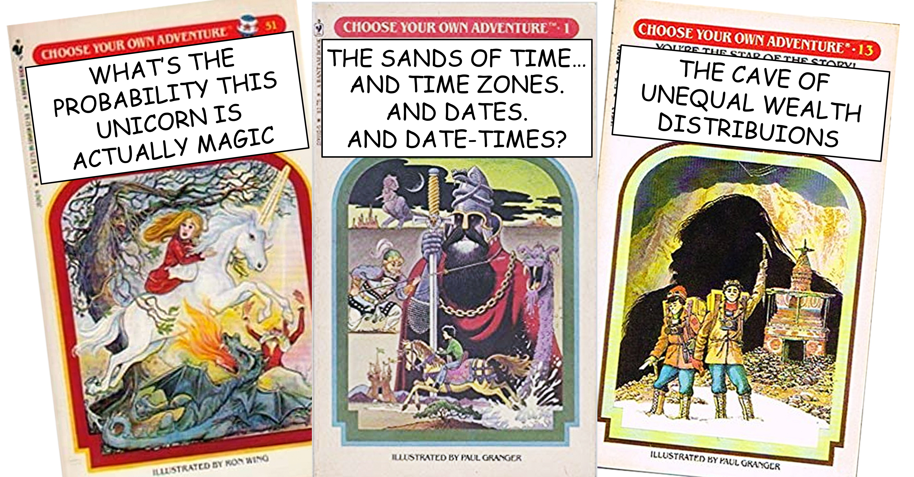

This culminating case study is like a "choose your own adventure" book. You get to choose the topic and the data! Your project should demonstrate the skills you learned in this class, including importing, wrangling, visualizing, and interpreting data. Specific requirements are listed in the Tasks section.

::: panel-tabset
## Resources

Most of the resources to help you develop a good question and find good data are contained in the other tasks related to the semester project, [Asking Questions](Task_03_questions.qmd) and [Data Search](Task_12_get_data.qmd).

You do not have to change the typical format we have been using this semester, but it might be fun to experiment. You can learn about different flavors of Rmarkdown here:

[Chapter 29 Quarto formats: R for Data Science (2nd ed)](https://r4ds.hadley.nz/quarto-formats)

If you have a quality project, you are encouraged to make it publicly available by publishing it to R Studio Connect via BYU-Idaho's Shiny Server, or posting it on your own GitHub account or personal blog.

## Task

Students always ask how involved or big the project needs to be. Your project should be on the scale of a large task. It should use and demonstrate the skills we learned in this class. It should include wrangling, some visualization (most likely 2 or more charts), and thoughtful analysis. It should include discussion and interpretation of the results. (Including techniques learned in other classes is okay and encouraged, as long as the skills learned in this class are also present).

Present your visualization-based analysis that addresses your question then get lots of feedback. This can be a springboard to a Senior Project or it can be what gets you a job offer. Ideas for receiving feedback (in order of effort involved):

-   Present your analysis to your roommates (or spouse) and update your presentation based on the feedback.

-   If possible, get feedback from two to three fellow classmates on your presentation and update it based on their feedback.

-   If possible, present your draft presentation to a data scientist to review for clarity.

-   If possible, present your work at a society meeting, the research and creative works conference, or as an online blog or link.

-   Remember, Rstudio connect can serve as a public location to link to. You can also set up your own GitHub account and make it public. You could then link your post to these locations for people to see your code and/or graphics.

You will briefly review the semester project with the teacher in your exit interview

### Specifics

Your semester project should include

-   Import: Load at least one dataset from a remote source.
-   Wrangle:
    -   Basic Wrangle: Use at least two of the following: select(), filter(), mutate(), arrange(), slice().
    -   Grouped Wrangle: use at least two of the following: group_by(), summarize(), count().
    -   Combine and Reformat: Most likely will need something like: bind(), join(), pivot().
-   Visualize:
    -   Geometry: Use geom\_\*() functions appropriately to communicate your data.
    -   Aesthetics: Use aes() appropriately to connect variables in your data with important aesthetics in your chart.
    -   Theme: Demonstrate you know how to edit theme elements to enhance the message of the chart.
-   Interpret: Describe the insights gained from your wrangling and visualizations, and discuss how those insights might impact actions or decisions.

### Submit

In I-learn submit a link to your `html` file hosted on your own personal repo's GitHub pages.
:::
