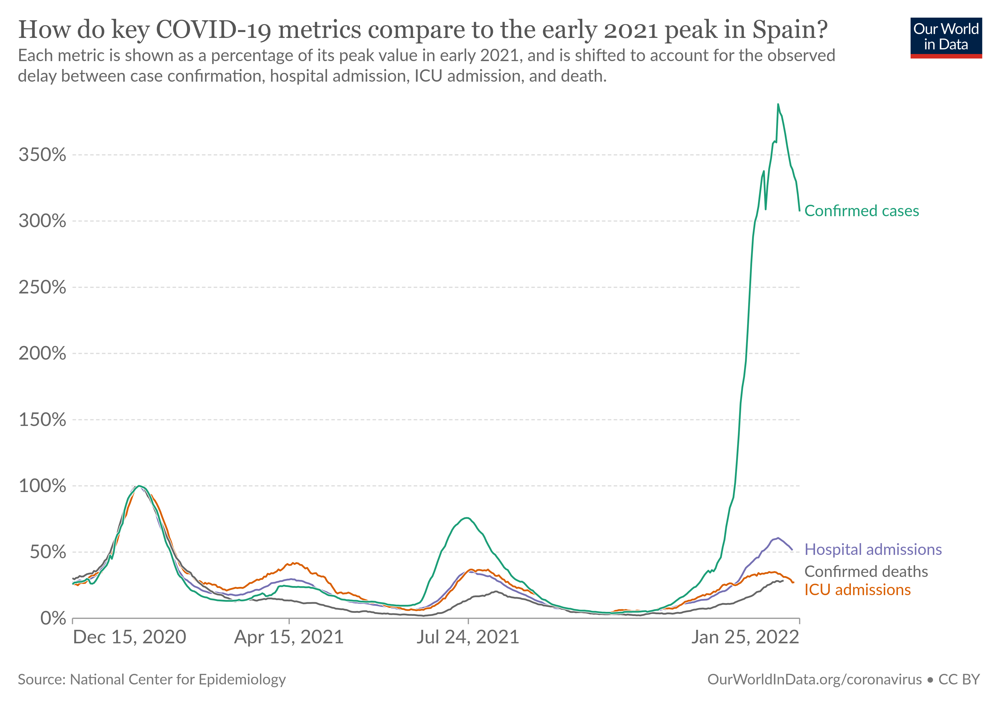

::: panel-tabset
## Resources

<!-- NOTE: This can be used immediately following Task_09_stock_table.qmd assignment, the readings below are identical. That assignment uses .rds data and this one doesn't. I think I plan to do this mostly in-class as an activity rather than a task for homework -->

### Readings

::: panel-tabset
## Traditional

-   [Chapter 11.5: R for Data Science---Writing and Saving Data](https://r4ds.had.co.nz/data-import.html#writing-to-a-file)
-   [Chapter 12: R for Data Science---Tidy Data](http://r4ds.had.co.nz/tidy-data.html)
-   [RDS vs. RData](http://www.sthda.com/english/wiki/saving-data-into-r-data-format-rds-and-rdata)
    -   By the way, contrary to what the article suggests, I don't believe saving your workspace is a good idea unless you think you'll need it. It just slows down your computer. That's the point of a script or markdown file, all the code is already saved so you can reproduce the workspace if necessary.

## Interactive Primer

-   [Chapter 11.5: R for Data Science---Writing and Saving Data](https://r4ds.had.co.nz/data-import.html#writing-to-a-file)
-   [Tidy Your Data](https://posit.cloud/learn/primers/4)
    -   Reshape Data
    -   Separate and Unite Columns
-   [RDS vs. RData](http://www.sthda.com/english/wiki/saving-data-into-r-data-format-rds-and-rdata)
    -   By the way, contrary to what the article suggests, I don't believe saving your workspace is a good idea unless you think you'll need it. It just slows down your computer. That's the point of a script or markdown file, all the code is already saved so you can reproduce the workspace if necessary.
:::

### Guided Instruction

1.  [tidyr](https://byuistats.github.io/M335/online_class/week4-tidyr.Rmd)
2.  [Reading and Writing R files](https://byuistats.github.io/M335/online_class/week4-reading-writing_Rfiles.Rmd)

## Background

"To pivot or not to pivot?", that is the question. When do we need to pivot our data, and when can we leave it as is? Wider formats are often easier for humans to read and parse in a large grid/table. However, the tidyverse generally assumes your data is presented in a longer format. If our data has been stored in a wide format, we’ll have to first pivot longer before we can do anything with the data. On the other hand, we may have to pivot wider to create a table of the data that’s easier for humans to process.

Consider the following data, with an accompanying chart.

https://byuistats.github.io/DS350_2022/files/to-pivot-or-not/spain-covid-cases-hospital-icu-deaths.csv (Source.)



The following code uses `pivot_longer` to appropriately wrangle the last 4 columns of the data set into two columns (type and value), and then constructs a bare bones (ignoring theme elements) plot to visualize the data.

```{r}
#| include: false
library(tidyverse)
```


```{r}
#| echo: true

my_d0 <- rio::import("https://byuistats.github.io/DS350_2022/files/to-pivot-or-not/spain-covid-cases-hospital-icu-deaths.csv")

my_tidy0 <- my_d0 %>% 
  filter(Entity == "Spain") %>% 
  pivot_longer(cols = c(-Entity,-Code,-Day), 
               names_to = "type", 
               values_to = "value")

my_tidy0 %>% 
  ggplot(aes(x = Day, y = value, color = type)) +
  geom_line()
```

This rough visualization can certainly be improved, but the wrangling phase and basic plot creation is complete. Our goal in this task is to practice this process several times, on various data sets, asking each time if pivoting is needed and then creating the bare bones replica of the graph.


## Task

There are 6 visualizations below, each with a link to their accompanying data and the source location on OurWorldInData. Appropriately wrangle the data to create a rough visualization. Some will need a pivot_longer() command, while others won’t. Once you have made each basic visualization, add in theme elements (title, labels, caption, axes, annotations, etc.) that you have struggle with before. If you’re already a pro at adding titles, then skip it and focus on something you can improve.

1. https://byuistats.github.io/DS350_2022/files/to-pivot-or-not/share-of-adults-who-smoke.csv ([Source](https://ourworldindata.org/grapher/share-of-adults-who-smoke?tab=chart&country=High+income~Lower+middle+income~Middle+income~Sub-Saharan+Africa+%28excluding+high+income%29~Upper+middle+income~OWID_WRL).)


2. https://byuistats.github.io/DS350_2022/files/to-pivot-or-not/climate-change-ocean.csv ([Source](https://ourworldindata.org/explorers/climate-change?facet=none&country=~OWID_WRL&Metric=Ocean+heat+content+%28top+700m%29&Long-run+series%3F=false).)


3. https://byuistats.github.io/DS350_2022/files/to-pivot-or-not/access-drinking-water-stacked.csv ([Source](https://ourworldindata.org/grapher/access-drinking-water-stacked?country=OWID_WRL~Low+income~Upper-middle+income~High+income~Lower-middle+income~Sub-Saharan+Africa~Central+and+Southern+Asia~North+America+and+Europe~Latin+America+and+the+Caribbean~Western+Asia+and+Northern+Africa). Make sure you look up the difference between `geom_bar` and `geom_col`. Feel free to pick 4 groups, instead of all 10, when you filter. It’s OK if your initial rough visualization doesn’t have the bars in the correct order.)


4. https://byuistats.github.io/DS350_2022/files/to-pivot-or-not/lead-blood-usa-children.csv ([Source](https://ourworldindata.org/grapher/lead-blood-usa-children?country=95th+percentile~Median).)


5. https://byuistats.github.io/DS350_2022/files/to-pivot-or-not/climate-change-antarctica.csv ([Source](https://ourworldindata.org/explorers/climate-change?facet=none&country=OWID_WRL~ATA&Metric=Antarctic+sea+ice+extent&Long-run+series%3F=false).)


6. https://byuistats.github.io/DS350_2022/files/to-pivot-or-not/primary-enrollment-selected-countries.csv ([Source](https://ourworldindata.org/grapher/primary-enrollment-selected-countries?facet=entity&country=HUN~GBR~CHN~IND~NER~ARG~JPN~AUT~BRB~BEN~BRA~KHM~CHL~CUB~DNK~LBR~LBY~MYS~MLI~MOZ~NPL~NLD~PAN~PER~POL~ECU~SLV~SWZ~FIN~GMB~DEU~GRC~GTM~GUY~HTI~ROU~SEN~SRB~SLE~LKA~SDN~CHE~SYR~TGO~TTO~VEN~YEM~ZWE~ZMB). Feel free to filter to include 4 countries, rather than 49, and get them in a 2 by 2 grid.)


Render the `.qmd`. Push the `.qmd`, `.md`, and `.html` files to your GitHub repository.

### Submit

In I-learn submit a link to the `.md` file on GitHub.
:::
